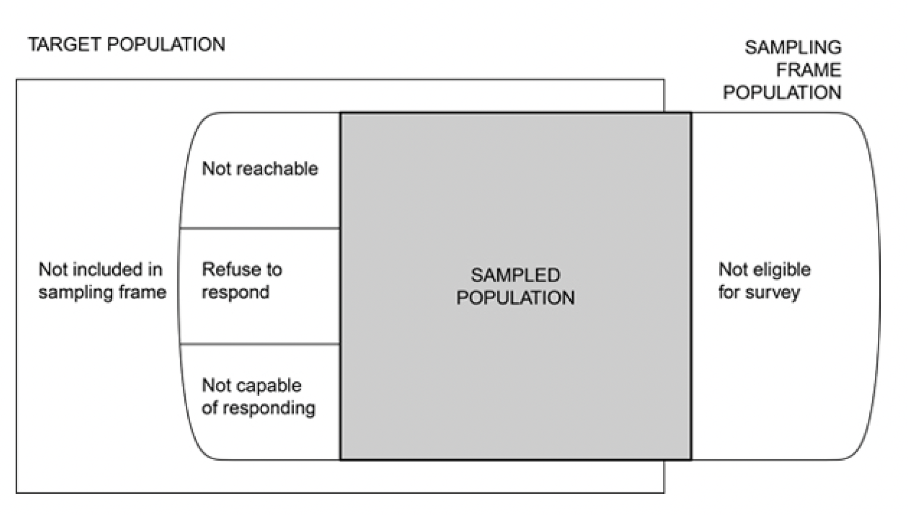
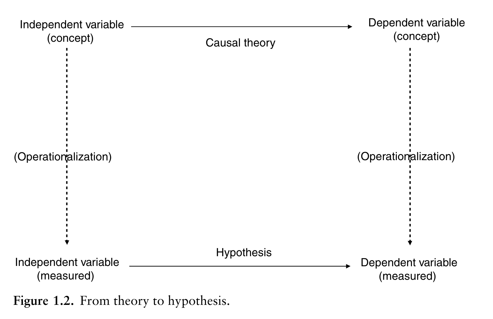
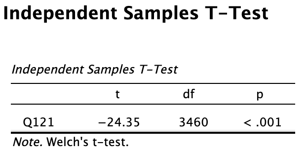

```{r setup, include=FALSE}

knitr::opts_chunk$set(echo = TRUE, message = FALSE, warning = FALSE,
                      dev = 'svglite', out.width = "45%", fig.width = 6,
                      fig.align="center")

options(scipen = 999)
```

## Acknowledgement of Country

I would like to acknowledge the Traditional Owners of Australia and  recognise their continuing connection to land, water and culture. The  University of Sydney is located on the land of the Gadigal people  of the Eora Nation. I pay my respects to their Elders, past and present.

# Chapter 8: Quantitative Methods

---

## Any question concerning the content for this week?

---

## Plan for today

1. Quantitative approaches to data collection: observation, survey, experiment
2. Sampling — then Task 1 (group)
3. Measurement: operationalisation, validity and reliability
4. Experiments in your proposal: designs and threats to validity
5. Probability
6. Estimating from samples
7. Hypothesis testing and the *t*-test
8. A3 in-class quiz + check-in

::: callout-note
**A1 viva voce** runs this week. A1 only draws on Weeks 1–8 — today's content is not examined in A1, but you will need it for your A2 method section.
:::

---

## Today's Learning Objectives {.smaller}

By the end of today's class, you will be able to:

1. **Data Collection Approaches**: Distinguish between observational studies, surveys, and experiments, and identify when each is appropriate

2. **Sampling**: Understand sampling terminology (population, sample, sampling frame) and distinguish between random and biased sampling methods

3. **Measurement**: Explain operationalisation, understand validity and reliability, and recognise how abstract concepts are measured quantitatively

4. **Probability**: Understand basic probability distributions (binomial and normal), interpret probability density, and recognise the role of probability in statistical inference

5. **Estimation**: Calculate and interpret estimates of population parameters (mean, standard deviation) from sample statistics, and understand confidence intervals

6. **Hypothesis Testing**: Formulate null and alternative hypotheses, interpret p-values correctly, and recognise the logic of statistical significance testing

# 1. The three approaches to collecting data: observation, survey, experiment

---

## Three approaches to collecting data {.smaller}

### 1. Observational study (no intervention)

* Quantitative description and association of observed variables (e.g, country-level statistics, social media data, documents)

### 2. Survey design (asking questions, the workhorse of social sciences)

* Quantitative description of trends, attitudes, or opinions of a population
* Testing association
* Studying a sample of that population

### 3. Experimental Design (rarer in the social sciences)

* Systematic manipulation of one or more variables to evaluate an outcome
* Holds other variables constant to isolate effects
* Generalize to a broader population

---

## The three approaches to collecting data: observation, survey, experiment

|                       | Observation | Survey | Experiment |
|-----------------------|-------------|--------|------------|
| Intervention          | NO          | YES    | YES        |
| Variable manipulation | NO          | NO     | YES        |

---

## Mentimeter quiz

### 1. Data Collection Approaches

::: {style="text-align: center;"}
</img>

or https://www.menti.com/alhnkyv2z61j
:::

# 2. Sampling: How do you do it?

---

## Sampling (observational study, survey or experiment) {.smaller}

::: {style="text-align: center;"}
</img>
:::

* **Target population** The complete collection of observations we want to study.

* **Sample** A subset of a population.

* **Sampled population** The collection of all possible observation units that might have been chosen in a sample.

* **Sampling unit** A unit that can be selected for a sample. Documents, individuals, households.

* **Sampling frame** A list, map, or other specification of sampling units in the population from which a sample may be selected. A list of telephone numbers, street names, farms, documents.

::: aside
Lohr, S. L. (2021). Sampling: Design and Analysis. Chapman and Hall/CRC. https://doi.org/10.1201/9780429298899
:::

---

## Target population vs sampled population {.smaller}

::: {style="text-align: center;"}
</img>
:::

::: {style="font-size: 0.85em; line-height: 1.25;"}
> **Target population** and **sampled population** in a *telephone survey* of *registered voters*. Some persons in the target population do not have a telephone or will not be associated with a telephone number in the sampling frame. In some households with telephones, the residents are not registered to vote and hence are not eligible for the survey. Some eligible persons in the sampling frame population do not respond because they cannot be contacted, some refuse to respond to the survey, and some may be ill and incapable of responding.
:::

::: aside
Lohr, S. L. (2021). Sampling: Design and Analysis. Chapman and Hall/CRC. https://doi.org/10.1201/9780429298899
:::

---

## Types of sampling

Once you have defined your **sampling frame** and your **sample size** ($n$=sample size, $N$=population size), you can finally draw your **sample**.

How do you do it in practice?

- **Random sampling**: You randomly (must be true randomness!) select from your sampling frame (i.e., list)

- **Convenience sampling**: You choose your sample based on convenience and access (more practical, but not ideal!)

---

## Population stratification

Your population is stratified based on characteristics of interest before sampling (e.g., gender, ethnicity). This gives more control on the representation of these characteristics in the final sample.

::: {style="text-align: center;"}
</img>
:::

::: {style="font-size: 0.85em; line-height: 1.25;"}
::: callout-note
The allocation population-sample can be *proportionate* or *disproportionate*, if you want a larger proportion in your sample of some individuals because their characteristics present more variability.
:::
:::

---

## Task 1: Sampling (group)

::: {style="text-align: center;"}
</img>
:::

```{r echo = FALSE}
library(countdown)

countdown(minutes = 15, seconds = 00)
```

# 3. Measurement: Operationalisation and variable construction

---

## A quantitative study tests a theory by

* testing an hypothesis,

* by measuring through operationalisation abstract concepts.

::: {style="text-align: center;"}
</img>
:::

::: aside
Kellstedt, P. M., & Whitten, G. D. (2013). The fundamentals of political science research. Cambridge University Press.
:::

---

## Instrumentation: In your proposal... (from the textbook) {.smaller}

* Name the survey instrument (e.g. telephone survey) used to collect data
* Indicate how instrument was developed
* Describe the established validity scores (e.g., questions/variables) from past use
  * Content validity
  * Predictive or concurrent validity
  * Construct validity
* Describe reliability of scores from past use
  * Internal consistency
  * Test-retest
* Discuss pilot testing or field-testing
  * Rationale for plans
  * Content validity and reliability
  * Improve question
* Steps for administering for a mailed survey

---

## Validity vs Reliability (from textbook) {.smaller}

::: {style="font-size: 0.95em; line-height: 1.25;"}

### Validity: can you draw accurate inferences from scores on the instruments?

* **Construct validity**: Does the survey instrument accurately measure the hypothetical construct or concept it was intended to measure?

* **Concurrent or criterion validity**: Does the survey instrument associate with other gold-standard measures of the construct or predict a criterion measure?

### Reliability: using this instrument (i.e., question) can you consistently repeat the same measurement?

* **Internal consistency**: do the items of a scale hang together? (Cronbach's $\alpha$, ideally .7–.9)
* **Test–retest**: do the same respondents get similar scores when the instrument is administered again later?

::: callout-note
**Internal** and **external** validity *mostly* refers to experiment settings. Internal validity is about biases (e.g., selection bias) that can threaten *internal* inferences. External validity is about generalisation of findings outside of the sample, that is *external* inferences about individuals not in the sample.
:::

:::

---

## Mentimeter quiz

### 2. Measurement Concepts

::: {style="text-align: center;"}
</img>

or https://www.menti.com/alhnkyv2z61j
:::

# 4. Experiments in your proposal (from the textbook)

---

## Types of experimental design

- **Pre-experimental**: a single group receives the treatment — no control group
- **Quasi-experiment**: control and treatment groups, but **no random assignment**
- **True experiment**: participants are **randomly assigned** to groups
- **Single-subject**: one individual observed repeatedly over time (baseline → treatment → baseline)

Describe your design with Campbell & Stanley's notation:

- **X** = exposure to the treatment · **O** = observation/measurement · **R** = random assignment
- Left → right = time order

---

## Designs in Campbell & Stanley notation {.smaller}

```{r echo = FALSE, fig.height = 5}
DiagrammeR::grViz("
digraph cs {
  rankdir = LR; compound = true; nodesep = 0.15; ranksep = 0.35
  node [shape = plaintext, fontname = Helvetica, fontsize = 14]
  edge [arrowhead = none, penwidth = 1.5]

  subgraph cluster1 { label = <<b>Pre-experimental</b>: one-group pretest–posttest>; labeljust = l; color = '#c0392b'
    a1 [label = 'Group A'];  o1 [label = 'O'];  x1 [label = <<font color='#c0392b'><b>X</b></font>>];  p1 [label = 'O']
    a1 -> o1 [style = invis]; o1 -> x1 -> p1 }

  subgraph cluster2 { label = <<b>Quasi-experimental</b>: nonequivalent control group (no R)>; labeljust = l; color = '#e08e0b'
    a2 [label = 'Group A']; o2 [label = 'O']; x2 [label = <<font color='#c0392b'><b>X</b></font>>]; p2 [label = 'O']
    b2 [label = 'Group B']; q2 [label = 'O']; y2 [label = '']; r2 [label = 'O']
    a2 -> o2 [style = invis]; o2 -> x2 -> p2
    b2 -> q2 [style = invis]; q2 -> y2 -> r2
    {rank = same; a2; b2} }

  subgraph cluster3 { label = <<b>True experiment</b>: pretest–posttest control group>; labeljust = l; color = '#2e8b57'
    a3 [label = <Group A  <b>R</b>>]; o3 [label = 'O']; x3 [label = <<font color='#c0392b'><b>X</b></font>>]; p3 [label = 'O']
    b3 [label = <Group B  <b>R</b>>]; q3 [label = 'O']; y3 [label = '']; r3 [label = 'O']
    a3 -> o3 [style = invis]; o3 -> x3 -> p3
    b3 -> q3 [style = invis]; q3 -> y3 -> r3 }

  subgraph cluster4 { label = <<b>True experiment</b>: posttest-only control group>; labeljust = l; color = '#2e8b57'
    a4 [label = <Group A  <b>R</b>>]; o4 [label = '']; x4 [label = <<font color='#c0392b'><b>X</b></font>>]; p4 [label = 'O']
    b4 [label = <Group B  <b>R</b>>]; q4 [label = '']; y4 [label = '']; r4 [label = 'O']
    a4 -> o4 [style = invis]; o4 -> x4 [style = invis]; x4 -> p4
    b4 -> q4 [style = invis]; q4 -> y4 [style = invis]; y4 -> r4 }
}
")
```

**O** = observation · **X** = treatment · **R** = random assignment · time runs left → right

---

## Threats to internal validity (Table 8.5) {.smaller}

Can you conclude that the *treatment* — and not something else — changed the outcome?

::: {style="font-size: 0.85em; line-height: 1.25;"}

| Threat | What goes wrong |
|---|---|
| **History** | Outside events during the study influence the outcome |
| **Maturation** | Participants change naturally over time |
| **Regression to the mean** | Participants selected for extreme scores drift toward the mean |
| **Selection** | Groups differ in ways that predispose their outcomes |
| **Mortality (attrition)** | Participants drop out, so their outcomes are unknown |
| **Diffusion of treatment** | Treatment and control groups communicate |
| **Compensatory/resentful demoralisation** | The control group resents not getting the treatment |
| **Compensatory rivalry** | The control group tries harder because it feels devalued |
| **Testing** | Participants remember the pretest |
| **Instrumentation** | The instrument changes between pretest and posttest |

:::

---

## Threats to external validity (Table 8.6)

Can you generalise from your sample to other **people**, **settings**, and **times**?

- **Selection × treatment**: a narrow sample — can't generalise to people unlike your participants
- **Setting × treatment**: a unique setting — can't generalise to other settings
- **History × treatment**: results are time-bound — can't generalise to past or future situations

::: callout-note
In your proposal: **name** the specific threats to your design, **explain** what each would mean for your study, and **say how** you'll address it.
:::

# 5. Probability

---

## Why Probability Matters {.smaller}

Imagine a poll says 23% of Australian voters support a party.

**The poll surveyed:** 1,000 voters (*sample* size, $n$)

**Total Australian voters:** 18.126 million (*population* size, $N$)

  - Note that this is not the whole Australian population (~27.2 million) but Australians on "the electoral roll" according to the Australian Electoral Commission (AEC)

**Question:** How can we trust this represents everyone?

**Answer:** Probability theory!

This is the bridge from *describing data* to *making inferences*.

- Describing the data (i.e. our sample!) is what we call **descriptive statistics**

- Using the sample to make observation about the population is what we call **inferential statistics**

---

## Two Views of What we Should Mean with "Probability"

### Frequentist View

- **Probability = long-run frequency**
- "If I flip this coin infinitely many times, 50% will be heads"
- **Objective**, but limited to repeatable events

### Bayesian View

- **Probability = degree of belief**
- "I'm 80% confident it will rain tomorrow"
- More flexible, but **subjective**

We'll use the frequentist approach (most common in the social sciences).

---

## Basic Probability Rules

**Key Concepts**

- Probabilities range from 0 (impossible) to 1 (certain)
- All possible outcomes sum to 1
- $P(\text{not } A) = 1 - P(A)$

**Example: Rolling a die**

- P(rolling a 4) = 1/6 ≈ 0.167
- P(not rolling a 4) = 5/6 ≈ 0.833

---

## Probability Distributions

**What is a Probability Distribution?**

- Describes how probabilities are spread across possible outcomes
- Two types:
  - **Discrete**: Countable outcomes (e.g., coin flips)
  - **Continuous**: Infinite possible values (e.g., height, IQ)

---

## The Binomial Distribution {.smaller}

**For Counting "Successes"**

- Used when:
  - Fixed number of **trials** ( $N$ )
  - Each trial has two **outcomes** (success/failure)
  - Probability of success ( $θ$ ) is **constant** (probability describes the underlying *theoretical* model for generating the data, in this case a dice)

:::: columns
::: {.column width="50%"}
::: {style="text-align: center;"}

:::
:::
::: {.column width="50%"}
**Example**: Rolling 20 dice, counting "💀"

- $N$ = 20 trials
- $θ$ = 1/6 (probability of "💀"), **the**ta for "**the**oretical probability"
:::
::::

---

## Binomial Distribution - Visual

**Example**: 20 dice rolls, $P(💀) = 1/6$

Most likely outcome: 3-4 skulls — getting exactly 10 skulls would be very surprising! The distribution shows what to expect.

```{r echo = FALSE, fig.width=12, fig.height=4, out.width="100%"}
library(ggplot2)

# Set parameters
set.seed(123)
n_trials <- 20
prob_skull <- 1/6
n_simulations <- 10000

# Generate data
skulls <- rbinom(n_simulations, size = n_trials, prob = prob_skull)
x_values <- 0:20
theoretical_prob <- dbinom(x_values, size = n_trials, prob = prob_skull)

# Prepare data frames
sim_data <- data.frame(skulls = skulls)
theory_data <- data.frame(x = x_values, probability = theoretical_prob)

# ============================================
# CHART 1: Theoretical Distribution Only
# ============================================

chart1 <- ggplot(theory_data, aes(x = x, y = probability)) +
  geom_col(fill = "red", alpha = 0.7, width = 0.7) +
  geom_point(color = "darkred", size = 3) +
  # Highlight 2-4 skulls (most likely range)
  annotate("rect", xmin = 1.5, xmax = 4.5,
           ymin = 0, ymax = max(theoretical_prob) * 1.1,
           alpha = 0.2, fill = "green", color = "darkgreen",
           linetype = "dashed", size = 1) +
  annotate("text", x = 3, y = max(theoretical_prob) * 0.95,
           label = "Most likely:\n2-4 skulls",
           color = "darkgreen", fontface = "bold", size = 5) +
  geom_vline(xintercept = 10, linetype = "dashed",
             color = "orange", size = 1.2) +
  annotate("text", x = 10.5, y = max(theoretical_prob) * 0.7,
           label = "10 skulls\n(very rare!)",
           color = "orange", fontface = "bold", size = 4, hjust = 0) +
  labs(title = "Theoretical Binomial Distribution",
       subtitle = "P(skull) = 1/6, n = 20 dice rolls",
       x = "Number of Skulls",
       y = "Probability") +
  scale_x_continuous(breaks = seq(0, 20, 2)) +
  theme_minimal(base_size = 14) +
  theme(plot.title = element_text(face = "bold", hjust = 0.5, size = 16),
        plot.subtitle = element_text(hjust = 0.5, size = 12),
        panel.grid.minor = element_blank())

# ============================================
# CHART 2: Observed Data Only
# ============================================

chart2 <- ggplot(sim_data, aes(x = skulls)) +
  geom_histogram(aes(y = after_stat(density)),
                 binwidth = 1,
                 fill = "steelblue",
                 color = "white",
                 alpha = 0.8) +
  annotate("text", x = 11, y = max(theoretical_prob) * 0.9,
           label = sprintf("10,000 samples\nMean: %.2f\nSD: %.2f",
                          mean(skulls), sd(skulls)),
           color = "steelblue", fontface = "bold", size = 3,
           hjust = 0) +
  labs(title = "Observed Results from Data",
       subtitle = "What we actually see in 10,000 experiments",
       x = "Number of Skulls",
       y = "Probability Density") +
  scale_x_continuous(breaks = seq(0, 20, 2), limits = c(0,20)) +
  theme_minimal(base_size = 14) +
  theme(plot.title = element_text(face = "bold", hjust = 0.5, size = 16),
        plot.subtitle = element_text(hjust = 0.5, size = 12),
        panel.grid.minor = element_blank())

# ============================================
# CHART 3: Overlay - Theory + Observations
# ============================================

chart3 <- ggplot() +
  # Observed data (histogram)
  geom_histogram(data = sim_data,
                 aes(x = skulls, y = after_stat(density)),
                 binwidth = 1,
                 fill = "steelblue",
                 color = "white",
                 alpha = 0.6) +
  # Theoretical distribution (line and points)
  geom_line(data = theory_data,
            aes(x = x, y = probability),
            color = "red", size = 1.5) +
  geom_point(data = theory_data,
             aes(x = x, y = probability),
             color = "red", size = 3) +
  # Highlight most likely region (2-4 skulls)
  annotate("rect", xmin = 1.5, xmax = 4.5,
           ymin = 0, ymax = max(theoretical_prob) * 1.1,
           alpha = 0.15, fill = "green") +
  annotate("text", x = 3, y = max(theoretical_prob) * 0.95,
           label = "2-4 skulls\nmost likely",
           color = "darkgreen", fontface = "bold", size = 4) +
  # Mark unlikely outcome
  geom_vline(xintercept = 10, linetype = "dashed",
             color = "orange", size = 1) +
  annotate("text", x = 10.5, y = max(theoretical_prob) * 0.7,
           label = "Very rare!",
           color = "orange", fontface = "bold", size = 4, hjust = 0) +
  # Legend
  annotate("text", x = 11, y = max(theoretical_prob) * 0.50,
           label = "Blue bars = Observed\nRed line = Theory",
           color = "black", fontface = "bold", size = 3,
           hjust = 0) +
  labs(title = "Theory vs. Reality: Perfect Match!",
       subtitle = "Simulated data matches theoretical predictions",
       x = "Number of Skulls",
       y = "Probability") +
  scale_x_continuous(breaks = seq(0, 20, 2)) +
  theme_minimal(base_size = 14) +
  theme(plot.title = element_text(face = "bold", hjust = 0.5, size = 16),
        plot.subtitle = element_text(hjust = 0.5, size = 12),
        panel.grid.minor = element_blank())

# ============================================
# Display all three side by side
# ============================================

library(gridExtra)
grid.arrange(chart1, chart2, chart3, ncol = 3)

```

---

## **Theoretical** probability vs **observed** frequency (1/2) {.smaller}

```{r echo = FALSE}
library(knitr)
library(kableExtra)

# Set parameters
set.seed(123)
n_trials <- 20
prob_skull <- 1/6
n_simulations <- 10000

# Generate simulated data
skulls <- rbinom(n_simulations, size = n_trials, prob = prob_skull)

# Calculate theoretical probabilities
x_values <- 0:20
theoretical_prob <- dbinom(x_values, size = n_trials, prob = prob_skull)

# Count observed frequencies
observed_freq <- table(factor(skulls, levels = 0:20))
observed_prob <- as.numeric(observed_freq) / n_simulations

# Create comprehensive comparison table
comparison_table <- data.frame(
  `Number of Skulls` = x_values,
  `Theoretical Probability` = round(theoretical_prob, 4),
  `Theoretical %` = paste0(round(theoretical_prob * 100, 2), "%"),
  `Observed Frequency` = as.numeric(observed_freq),
  `Observed Probability` = round(observed_prob, 4),
  `Observed %` = paste0(round(observed_prob * 100, 2), "%"),
  `Difference` = round(observed_prob - theoretical_prob, 4)
)

```

```{r echo = FALSE, results = 'asis'}
knitr::kable(comparison_table[1:10,],
             col.names = c("Skulls", "Th. Prob", "Th. %",
                          "Obs. Freq", "Obs. Prob", "Obs. %", "Diff"),
             align = 'c',
             digits = 10,
             format = "html",
             row.names = FALSE)
```

---

## **Theoretical** probability vs **observed** frequency (2/2) {.smaller}

```{r echo = FALSE, results = 'asis'}
knitr::kable(comparison_table[11:21,],
             col.names = c("Skulls", "Th. Prob", "Th. %",
                          "Obs. Freq", "Obs. Prob", "Obs. %", "Diff"),
             align = 'c',
             digits = 10,
             format = "html",
             row.names = FALSE)
```

---

## 1950s: When Statistics Confronted Industry Deception {.smaller}

**The smoking - lung cancer link**

- 1950: Doll & Hill publish first major study
- Tobacco industry: "No proof smoking causes cancer"
- Industry claim: Cancer rates same for smokers/non-smokers
- **Statistical claim**: P(cancer) ≈ 1/6 regardless of smoking

:::: columns
::: {.column width="50%"}

```{r echo = FALSE, out.width='100%', fig.width = 6, fig.height = 4}
ggplot() +
  # Theoretical distribution (line and points)
  geom_line(data = theory_data,
            aes(x = x, y = probability),
            color = "red", size = 1.5) +
  geom_point(data = theory_data,
             aes(x = x, y = probability),
             color = "red", size = 3) +
  labs(x = "Lung cancer cases in a sample of size 20",
       y = "Probability") +
  scale_x_continuous(breaks = seq(0, 20, 2)) +
  theme_minimal(base_size = 14) +
  theme(plot.title = element_text(face = "bold", hjust = 0.5, size = 16),
        plot.subtitle = element_text(hjust = 0.5, size = 12),
        panel.grid.minor = element_blank())
```

:::
::: {.column width="50%" .fragment}

```{r echo=FALSE, message=FALSE, warning=FALSE, out.width='100%', fig.width = 8, fig.height = 5}

library(gridExtra)

# Create static snapshots at key points
create_snapshot <- function(n_studies) {
  subset_data <- data.frame(cases = all_trials$cases[1:n_studies])
  mean_obs <- mean(subset_data$cases)

  ggplot() +
    geom_line(data = theory_data, aes(x = x, y = probability),
              color = "red", size = 1.2) +
    geom_point(data = theory_data, aes(x = x, y = probability),
               color = "red", size = 2) +
    geom_histogram(data = subset_data, aes(x = cases, y = after_stat(density)),
                   binwidth = 1, fill = "steelblue", color = "white", alpha = 0.7) +
    geom_vline(xintercept = 20 * 1/6, linetype = "dashed",
               color = "red", size = 1) +
    geom_vline(xintercept = mean_obs, linetype = "dashed",
               color = "steelblue", size = 1) +
    annotate("text", x = 15, y = 0.24,
             label = sprintf("n=%d\nMean=%.1f", n_studies, mean_obs),
             fontface = "bold", size = 4) +
    labs(title = sprintf("After %d Studies", n_studies),
         x = "Cases per 20", y = "Density") +
    scale_x_continuous(breaks = seq(0, 20, 5), limits = c(0, 20)) +
    ylim(0, 0.26) +
    theme_minimal(base_size = 11) +
    theme(plot.title = element_text(face = "bold", hjust = 0.5))
}

# Generate data once
set.seed(1950)
all_trials <- data.frame(cases = rbinom(50, 20, 4/6))
theory_data <- data.frame(x = 0:20, probability = dbinom(0:20, 20, 1/6))

# Create 4 snapshots
p1 <- create_snapshot(1)
p2 <- create_snapshot(10)
p3 <- create_snapshot(25)
p4 <- create_snapshot(50)

grid.arrange(p1, p2, p3, p4, ncol = 2)

```

:::
::::

---

## The Normal Distribution

**The "Bell Curve"**

- Most important distribution in statistics
- Describes many natural phenomena
- Defined by two parameters:
  - **Mean ( $\mu$ )**: Center of distribution
  - **Standard deviation (SD or $\sigma$ )**: Spread of distribution

**Examples**: **Height**, **Weight**, but crucially also **Measurement Errors**

---

## Normal Distribution

**Properties**

- Symmetric around the mean
- 68.3% of data within 1 SD of mean
- 95.4% of data within 2 SD of mean
- 99.7% of data within 3 SD of mean

```{r echo = FALSE, fig.width = 6, fig.height = 4}
library(ggplot2)

# Parameters for adult height (in cm)
mu <- 170      # Mean height (cm) - roughly average adult
sigma <- 10    # Standard deviation (cm)

# Create data for the normal curve
x <- seq(mu - 4*sigma, mu + 4*sigma, length.out = 1000)
y <- dnorm(x, mean = mu, sd = sigma)
curve_data <- data.frame(x = x, y = y)

# Create the plot
ggplot(curve_data, aes(x = x, y = y)) +
  # The normal curve
  geom_line(size = 1.5, color = "black") +

  # Shade 68% region (within 1 SD)
  geom_area(data = subset(curve_data, x >= mu - sigma & x <= mu + sigma),
            aes(x = x, y = y), fill = "steelblue", alpha = 0.3) +

  # Shade 95% region (within 2 SD)
  geom_area(data = subset(curve_data, x >= mu - 2*sigma & x <= mu + 2*sigma),
            aes(x = x, y = y), fill = "lightblue", alpha = 0.2) +

  # Shade 99.7% region (within 3 SD)
  geom_area(data = subset(curve_data, x >= mu - 3*sigma & x <= mu + 3*sigma),
            aes(x = x, y = y), fill = "lightblue", alpha = 0.1) +

  # Vertical lines for mean and SDs
  geom_vline(xintercept = mu, linetype = "solid", color = "red", size = 1) +
  geom_vline(xintercept = c(mu - sigma, mu + sigma),
             linetype = "dashed", color = "steelblue", size = 0.8) +
  geom_vline(xintercept = c(mu - 2*sigma, mu + 2*sigma),
             linetype = "dashed", color = "lightblue", size = 0.8) +
  geom_vline(xintercept = c(mu - 3*sigma, mu + 3*sigma),
             linetype = "dashed", color = "lightblue", size = 0.8) +

  # Labels for standard deviations
  annotate("text", x = mu, y = max(y) * 1.05,
           label = expression(mu), size = 6, color = "red", fontface = "bold") +
  annotate("text", x = mu - sigma, y = max(y) * 0.5,
           label = expression(mu - sigma), size = 4, color = "steelblue") +
  annotate("text", x = mu + sigma, y = max(y) * 0.5,
           label = expression(mu + sigma), size = 4, color = "steelblue") +

  # Percentage labels
  annotate("text", x = mu, y = max(y) * 0.25,
           label = "68.3%", size = 5, fontface = "bold", color = "steelblue") +
  annotate("text", x = mu, y = max(y) * 0.15,
           label = "95.4%", size = 4.5, fontface = "bold", color = "blue") +
  annotate("text", x = mu, y = max(y) * 0.05,
           label = "99.7%", size = 4, fontface = "bold", color = "darkblue") +

  # Labels
  labs(title = "Normal Distribution: Adult Height",
       subtitle = expression(paste("Mean (", mu, ") = 170 cm, Standard Deviation (",
                                   sigma, ") = 10 cm")),
       x = "Height (cm)",
       y = "Probability Density") +

  # X-axis with meaningful breaks
  scale_x_continuous(breaks = seq(140, 200, 10),
                    labels = seq(140, 200, 10)) +

  # Theme
  theme_minimal(base_size = 14) +
  theme(plot.title = element_text(face = "bold", hjust = 0.5, size = 16),
        plot.subtitle = element_text(hjust = 0.5, size = 12),
        panel.grid.minor = element_blank())
```

---

## Why the Normal Distribution Matters

**Three Key Reasons**

1. Many real-world variables are normally distributed
2. Averages of random samples tend toward normal (Central Limit Theorem)
3. Makes statistical inference mathematically tractable

*"The normal distribution is... well, normal!"*

---

## Mentimeter quiz

### 3. Probability Distributions

::: {style="text-align: center;"}
</img>

or https://www.menti.com/alhnkyv2z61j
:::

# 6. Estimating from Samples

---

## Samples and Populations

**Key Distinction**

:::: columns
::: {.column width="50%"}
**Population**

- All possible observations
- Often theoretical or impractically large
- True parameters (unknown):
  - Mean: $\mu$
  - Standard deviation: $\sigma$
:::
::: {.column width="50%"}
**Sample**

- The data we actually collect
- Finite and observable
- Sample statistics (calculated):
  - Sample mean: $\bar{X}$
  - Sample SD: $s$
:::
::::

**Goal**: Use sample statistics to estimate population parameters

---

## Sampling Matters

::: callout-note
Sampling is the act of drawing individuals from a **population** of interest into your **sample** for **measurement**.
:::

**We Can't Measure Everyone!**

- Too expensive
- Too time-consuming
- Sometimes impossible

**Solution**: Study a sample and make inferences

- Political polls: Sample 1,000 voters from millions
- Drug trials: Sample hundreds from entire population

---

## Simple Random Sampling {.smaller}

::: callout-note
But **how** in practice you draw individuals from the population of interest matters a great deal.

- A representative small sample is infinitely better than a very large non-representative sample.

- Because a non-representative sample won't allow you to infer (i.e. estimate) population characteristics (e.g., Internet polls)
:::

:::: columns
::: {.column width="50%"}
**The Gold Standard**

- Every member of population has equal chance of selection
- No bias in selection process
- Allows valid statistical inference
:::
::: {.column width="50%"}
**Reality Check**

- In practice, not every individual has the same probability of being selected into the sample.
- Many samples are "convenience samples" (e.g. people are reached through phone or email instead of sending people to hunt them down)
- Because of this we must think and discuss carefully about generalisation and study's limitations
:::
::::

---

## The Law of Large Numbers {.smaller}

**Bigger Samples → Better Estimates**

:::: columns
::: {.column width="50%"}
**What Happens as Sample Size Grows:**

- Sample mean $\bar{X}$ gets closer to population mean $\mu$
- Estimates become more accurate
- Uncertainty decreases
- Random errors "cancel out"

**Mathematical Statement:**

$$\text{As } N \to \infty, \text{ then } \bar{X} \to \mu$$

*In plain English: With enough data, the sample mean converges to the true population mean*
:::
::: {.column width="50%"}
> "Even the most stupid of men... is convinced that the more observations have been made, the less danger there is of wandering from one's goal"
— Jacob Bernoulli, Ars Conjectandi (1713)

Why This Matters: This simple intuition forms the mathematical foundation for all of statistics!
:::
::::

---

## Sampling Distributions {.smaller}

**A Crucial Concept**

- If we repeated our experiment many times, we'd get different sample means each time
- The **sampling distribution** shows how these sample means are distributed

**Example**:

1. Sample 10 people, measure heights
   - Calculate mean → $\bar{X}_1 = 168$ cm
2. Sample 10 different people
   - Calculate mean → $\bar{X}_2 = 172$ cm
3. Sample 10 more people
   - Calculate mean → $\bar{X}_3 = 171$ cm
4. Repeat 10,000 times...
5. Plot all these means → **sampling distribution**

---

## Sampling Distribution - Visual {.smaller}

```{r echo = FALSE, fig.width = 10, fig.height = 4, out.width = "80%"}
library(ggplot2)
library(grid)
library(gridExtra)

set.seed(456)
pop_mean <- 170
pop_sd <- 10

# Create three plots with different sample sizes
create_sampling_plot <- function(n, title_text) {
  sample_means <- replicate(10000, mean(rnorm(n, pop_mean, pop_sd)))
  se <- pop_sd / sqrt(n)

  ggplot(data.frame(means = sample_means), aes(x = means)) +
    geom_histogram(aes(y = after_stat(density)),
                   bins = 40, fill = "steelblue",
                   color = "white", alpha = 0.7) +
    stat_function(fun = dnorm,
                  args = list(mean = pop_mean, sd = se),
                  color = "red", size = 1.2) +
    geom_vline(xintercept = pop_mean, color = "red",
               linetype = "dashed", size = 1) +
    labs(title = title_text,
         subtitle = sprintf("SE = %.2f", se),
         x = expression(bar(X)),
         y = "Density") +
    xlim(160, 180) +
    theme_minimal(base_size = 11) +
    theme(plot.title = element_text(face = "bold", hjust = 0.5, size = 12),
          plot.subtitle = element_text(hjust = 0.5, size = 10))
}

p1 <- create_sampling_plot(5, "n = 5")
p2 <- create_sampling_plot(10, "n = 10")
p3 <- create_sampling_plot(30, "n = 30")

grid.arrange(p1, p2, p3, ncol = 3,
             top = textGrob("How Sample Size Affects Sampling Distribution",
                           gp = gpar(fontsize = 16, fontface = "bold")))
```

:::: columns
::: {.column width="50%"}
**Distribution of Sample Means**

- Center: Population mean ( $\mu$ = 170 )
- Spread: Standard error ( $SE$ )
- Shape: Approximately normal (especially for large N)
:::
::: {.column width="50%"}
::: callout-note
**Key insight**: Sample means vary, but cluster around truth!
:::
:::
::::

---

## The Central Limit Theorem {.smaller}

**The Magic of Averaging**

:::: columns
::: {.column width="50%"}
**The Theorem:**

No matter what the population distribution looks like (skewed, uniform, bimodal), the distribution of sample means will be approximately normal when $N$ is large enough.

$$\text{As } N \to \infty: \quad \bar{X} \sim N\left(\mu, \frac{\sigma^2}{N}\right)$$
:::
::: {.column width="50%"}
**Three Guarantees:**

1. **Center**: $E(\bar{X}) = \mu$
   - Sample means average to true mean

2. **Spread**: $SE(\bar{X}) = \frac{\sigma}{\sqrt{N}}$
   - Precision increases with sample size

3. **Shape**: $\bar{X}$ is approximately normal
   - Even if original data aren't normal!
:::
::::

---

## The Central Limit Theorem - Visual

```{r echo=FALSE, fig.width=5, fig.height=6}
library(ggplot2)
library(gridExtra)
# Show CLT with skewed population
set.seed(42)
# Skewed population
pop <- rexp(10000, rate = 0.1)
p1 <- ggplot(data.frame(x = pop), aes(x = x)) +
geom_histogram(bins = 50, fill = "coral", alpha = 0.7) +
labs(title = "Population (Skewed!)",
x = "", y = "Count") +
theme_minimal(base_size = 10)
# Sampling distributions
means_n5 <- replicate(5000, mean(sample(pop, 5)))
means_n30 <- replicate(5000, mean(sample(pop, 30)))
p2 <- ggplot(data.frame(x = means_n5), aes(x = x)) +
geom_histogram(bins = 40, fill = "lightblue", alpha = 0.7) +
labs(title = "Sample Means (n=5)",
x = "", y = "Count") +
theme_minimal(base_size = 10)
p3 <- ggplot(data.frame(x = means_n30), aes(x = x)) +
geom_histogram(bins = 40, fill = "steelblue", alpha = 0.7) +
labs(title = "Sample Means (n=30) - Normal!",
x = expression(bar(X)), y = "Count") +
theme_minimal(base_size = 10)
grid.arrange(p1, p2, p3, ncol = 1)
```

**Key Insight**: This is why we can use normal-based methods even when data aren't normal!

# 7. Hypothesis testing

---

## The Logic of Hypothesis Testing {.smaller}

**Case Study: Smoking and Lung Cancer**

### The 1950s Debate

**Tobacco Industry Position:**

> "There is no proof that smoking causes lung cancer. Cancer rates are the same whether you smoke or not."

**Claimed probability**: $P(\text{cancer}) = \frac{1}{6} \approx 17\%$ for everyone (smokers and non-smokers in the adult population)

**This is our baseline hypothesis (a.k.a. the *null hypothesis*).**

::: callout-tip
$H_0$ Smokers have the same probability of getting lung cancer as adult non-smokers.
:::

---

## The Scientific Evidence {.smaller}

:::: columns
::: {.column width="50%"}
**Doll & Hill (1950) Study:**

- Followed 100 heavy smokers for 20 years
- Result: 13 developed lung cancer

**The Question:**

Is 13 cases significantly different from the 3-4 we'd expect if the industry claim were true?
:::
::: {.column width="50%"}
```{r echo=FALSE, fig.width=6, fig.height=6, out.width='100%'}
library(ggplot2)

# Show expected vs observed
data <- data.frame(
  Group = c("Expected\n(Industry Claim)", "Observed\n(Scientists)"),
  Cases = c(3.3, 13),
  Color = c("Industry", "Reality")
)

ggplot(data, aes(x = Group, y = Cases, fill = Color)) +
  geom_col(width = 0.6, alpha = 0.8) +
  geom_text(aes(label = Cases), vjust = -0.5,
            fontface = "bold", size = 6) +
  scale_fill_manual(values = c("Industry" = "lightblue",
                                "Reality" = "darkred")) +
  labs(title = "Lung Cancer Cases per 100 Smokers",
       subtitle = "Expected vs. Observed",
       y = "Number of Cancer Cases",
       x = "") +
  theme_minimal(base_size = 14) +
  theme(plot.title = element_text(face = "bold", hjust = 0.5, size = 16),
        plot.subtitle = element_text(hjust = 0.5, size = 12),
        legend.position = "none") +
  ylim(0, 15)
```
:::
::::

**The Statistical Question:** Could we see 13 cases by chance alone if the true rate is only 3-4 per 100? Hypothesis testing provides a formal framework for answering this.

---

## Null and Alternative Hypotheses {.smaller}

**Setting Up the Test**

:::: columns
::: {.column width="50%"}
**Null Hypothesis (H₀)**

- The "boring" hypothesis
- Usually "no effect" or "no difference"
- What the establishment claims

**Smoking example**:
$$H_0: \theta = \frac{1}{6}$$

"Smoking doesn't increase cancer risk. Cancer rate for smokers is same as general population (1/6 or 17%)"

**This is what we test AGAINST**
:::
::: {.column width="50%"}
**Alternative Hypothesis (H₁)**

- What we want to demonstrate
- The "interesting" claim
- Usually involves an effect or difference

**Smoking example**:
$$H_1: \theta \neq \frac{1}{6}$$

"Smoking DOES affect cancer risk. Cancer rate for smokers is different from 1/6"

**This is what we want to PROVE**
:::
::::

::: {style="text-align: center;"}
**Goal**: Use data to assess whether we can reject the null hypothesis.
:::

---

## Hypothesis Testing as a Trial {.smaller}

**Legal Analogy**

- **Defendant**: Null hypothesis
- **Prosecutor**: Researcher
- **Judge**: Statistical test
- **Presumption of innocence**: Assume $H_0$ is true
- **Burden of proof**: Must prove "beyond reasonable doubt"

**We protect the null hypothesis from false conviction!**

::: callout-note
- Yet no single study should completely convince us!
- What we want instead is **replication**: to reject $H_0$ consistently across many independent studies
- A statistical test will never tell us that an outcome is impossible, only that an outcome is unlikely given our baseline assumption (the $H_0$): It's not impossible to roll 20 "6" in a row, just unlikely under the assumption that the dice is fair.
:::

---

## Mentimeter quiz

### 4. Probability Distributions

::: {style="text-align: center;"}
</img>

or https://www.menti.com/alhnkyv2z61j
:::

---

## The $p$-value

**The Most Misunderstood Concept**

**What it is**:

- Probability of observing data this extreme (or more extreme) if $H_0$ is true
- Small $p$-value = data are surprising under $H_0$

**What it is NOT**:

- ✗ Probability that $H_0$ is true
- ✗ Probability that results are due to chance
- ✗ Importance of the effect

**Decision rule**: If $p < 0.05$, reject $H_0$

---

## Significance Levels

**Conventional Standards in the social sciences**

| **p-value** | **Interpretation** | **Stars** |
|---|---|---|
| p > .05 | Not significant | - |
| p ≤ .05 | Significant | * |
| p ≤ .01 | Highly significant | ** |
| p ≤ .001 | Very highly significant | *** |

---

## The t-tests

**When to use**:

- Outcome variable is continuous (interval/ratio scale)
- Want to compare means between groups
- One of the most common statistical tests with survey results

**Three types**:

1. One-sample t-test
2. Independent samples t-test
3. Paired samples t-test (we won't cover this today)

---

## One-Sample t-test {.smaller}

**Comparing Sample to Known Value**

**Question**: Is our sample mean different from a hypothesised value?

```{r echo=FALSE}
aus_mean <-
  175
aus_team <-
  c(206,  190, 204, 210, 194, 209, 207, 212, 211, 201, 198, 203, 191, 206)
this_test <-
  t.test(aus_team, mu = aus_mean)
```

**Example**:

- The average height for an adult male in Australia is `r aus_mean` cm.
- Here are the heights in cm of the current roster of Australia men's volleyball team: `r paste(aus_team, collapse = ", ")`.
- Is this significantly different?

**Test statistic**:

$$t = \frac{\bar{x} - \mu_0}{s/\sqrt{n}}$$

---

## Let's do some math! {.smaller}

$$t = \frac{\bar{x} - \mu_0}{s/\sqrt{n}}$$

- Adult male population mean ( $\mu_0$ ) or the *true value*: `r aus_mean` cm

- Team's mean ( $\bar{x}$ ): `r mean(aus_team)` cm

- Team's standard deviation ( $s$ ): `r round(sd(aus_team), 3)` cm

- Team's size ( $n$ ): `r length(aus_team)`

$$t = \frac{`r mean(aus_team)` - `r aus_mean`}{`r round(sd(aus_team), 3)`/\sqrt{`r length(aus_team)`}} = \frac{`r mean(aus_team) - aus_mean`}{`r round(sd(aus_team)/sqrt(length(aus_team)), 3)`} = `r round(this_test$statistic, 3)`$$

Nice, but what about the $p$-value? Once you have your test statistic (`r round(this_test$statistic, 3)`), you can get the corresponding p-value by looking into a statistical table or more likely using a statistical software like JASP.

In this case, $t = `r round(this_test$statistic, 3)`$, $p$-value = `r signif(this_test$p.value, 3)`, which is p < 0.05. Not surprisingly, we can reject the null hypothesis. The difference in averages (sample's mean vs *true value*) is **statistically significant**.

---

## Mentimeter quiz

### 5. P-values

::: {style="text-align: center;"}
</img>

or https://www.menti.com/alhnkyv2z61j
:::

---

## Independent Samples t-test {.smaller}

::: {style="font-size: 0.85em; line-height: 1.25;"}

**Comparing Two Different Groups**

**Question**: Do two groups have different means? (i.e., a statistically significant difference)

```{r echo = FALSE}
wvs_7 <- read.csv("../data/wvs_7.csv")
aus <- wvs_7$Q121[wvs_7$country %in% "AUS"]
uk <- wvs_7$Q121[wvs_7$country %in% "GBR"]
```

Let's use data from the World Values Survey (2022). The WVS collects survey data from different countries. We focus here on this question:

> Q121: How would you evaluate the impact of [immigrants] on the development of [your country]?

Possible answers are ordered (and therefore quantifiable) on a Likert scale

| Very good | Quite good | Neither good, nor bad | Quite bad | Very bad |
|---|---|---|---|---|
| 5 | 4 | 3 | 2 | 1 |

::: callout-note
Do Australians respond differently compared to UK respondents, and is this difference statistically significant?
:::

:::

::: aside
Haerpfer, C., Inglehart, R., Moreno, A., Welzel, C., Kizilova, K., Diez-Medrano J., M. Lagos, P. Norris, E. Ponarin & B. Puranen (eds.). 2022. World Values Survey: Round Seven – Country-Pooled Datafile Version 6.0. Madrid, Spain & Vienna, Austria: JD Systems Institute & WVSA Secretariat. doi:10.14281/18241.24
:::

---

## WVS Data and Test

- Australia: M = `r round(mean(aus), 3)`, SD = `r round(sd(aus), 3)`, N = `r length(aus)`
- UK: M = `r round(mean(uk), 3)`, SD = `r round(sd(uk), 3)`, N = `r length(uk)`

**Welch Two Sample t-test** — and here the result from the test!

::: {style="text-align: center;"}

:::

**Is the difference statistically significant?**

# Wrap-up

---

## A3 — In-class Quiz

Take 10 minutes to complete this week's A3 quiz on Canvas — worth 10 points, on Quantitative Methods (Ch. 8).

```{r echo = FALSE}
library(countdown)

countdown(minutes = 10, seconds = 00)
```

---

## Please take 2 mins to complete the anonymous Week 09 Student feedback survey (link from Canvas)

---

## Week 09 Check-in

Anything unclear from this week?

---

## See you next week with the first **Data Analysis Lab** (and remember to install JASP!)
