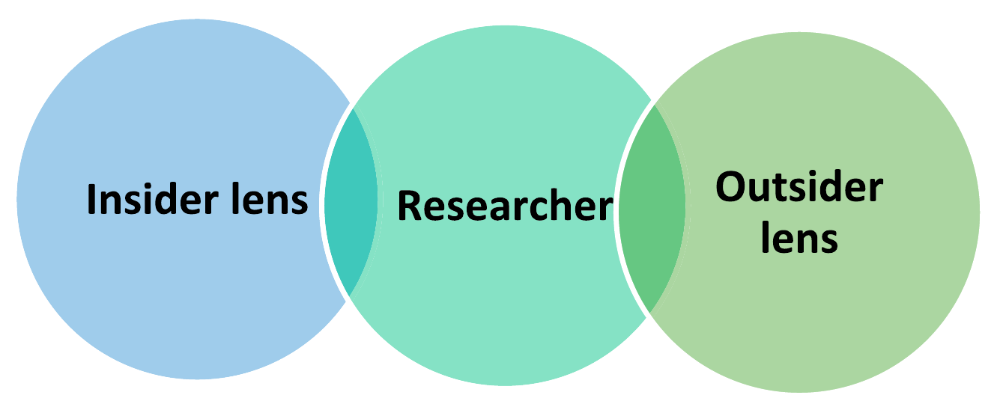

```{r setup, include=FALSE}

knitr::opts_chunk$set(echo = TRUE, message = FALSE, warning = FALSE,
                      dev = 'svglite', out.width = "45%", fig.width = 6,
                      fig.align="center")

options(scipen = 999)
```

## Acknowledgement of Country

I would like to acknowledge the Traditional Owners of Australia and  recognise their continuing connection to land, water and culture. The  University of Sydney is located on the land of the Gadigal people  of the Eora Nation. I pay my respects to their Elders, past and present.

# Chapter 9: Qualitative Methods

Based on Creswell & Creswell (2022), Ch. 9, with examples from Ercan & Vromen (2022)

---

## Any question concerning the content for this week?

---

## Plan for today

1. What is qualitative research, and when to use it
2. A2 workshop: peer-review your research design
3. Generating data: talking to people, collecting materials, observing
4. Recording data, ethics and sampling
5. Analysing data: coding, themes, validity and reliability
6. Writing the qualitative method section of your proposal
7. Group task: design a mini qualitative study
8. A3 in-class quiz + check-in

::: callout-note
Next week is the qualitative **Data Analysis Lab** — make sure you have **NVivo installed** on your laptop before class.
:::

---

## Today's Learning Objectives {.smaller}

By the end of today's class, you will be able to:

1. **Qualitative Research**: Explain what qualitative research is, its core characteristics, and when it is the right choice for a research question

2. **Generating Data**: Select appropriate methods (interviews, focus groups, documents, visual materials, observation) for a given question

3. **Recording, Ethics and Sampling**: Design an interview protocol, anticipate ethical issues, and justify a purposeful sample (and recognise saturation)

4. **Analysing Data**: Apply the seven-step coding process, distinguish types of codes, and choose validity and reliability strategies

5. **Designing**: Plan a qualitative research project and write it up as the method section of your proposal

# 1. What is qualitative research?

---

## What is Qualitative Research?

**Core Focus:**
Understanding the **meaning** underlying intentions, actions, objects, or phenomena

**Key Principle:**
Explanation cannot be independent of context

**Questions Answered:**

- **What** is happening? (descriptive)
- **How** did this occur? (process)
- **Why** did this happen? (explanatory)

**Method:**
In-depth analysis through 'thick' description, case studies, or small-N comparisons

---

## Core Characteristics

1. **Participants' meanings** - not researcher's preconceptions
2. **Natural settings** - not laboratories
3. **Researcher as instrument** - direct collection and interpretation
4. **Multiple data sources** - triangulation
5. **Context-dependent** - understanding within specific settings
6. **Textual and verbal focus** - including silences and omissions
7. **Reflexivity** - acknowledging researcher's role and biases

---

## The Approach or Design: Two Options (but one doesn't exclude the other) {.smaller}

:::: columns
::: {.column width="50%"}
### 1. Descriptive Methods

- Based on everyday language of participants
- Little interpretation from pre-existing theory
- Maximum variation in sampling
- Cataloguing data into themes

### 2. Analytic Frameworks

Examples: narrative study, phenomenology, grounded theory, ethnography, case study

- Specific frameworks for data collection and analysis
- Limited variability in application
- Popularised in specific disciplines
- Have philosophical foundations
:::

::: {.column width="50%"}
**When Writing About Your Design:**

1. Identify specific approach with literature references
2. Provide background information about the approach
3. Discuss why it's appropriate for your study
4. Identify how approach will shape your design process
:::
::::

---

## Research Topics in Political Science

*Applicable to Social Sciences Generally*

**Core Questions:**

- How are societies governed?
- How is power distributed and used?
- How are collective decisions made?
- How do actors interact with institutions?

**Levels of Analysis:**

- Macro: Institutional and structural forces
- Meso: Organisations, groups, movements
- Micro: Individual engagement and participation

---

## When to Use Qualitative Methods

**Ideal For:**

- Understanding meanings people give to actions
- Exploring processes and "how" questions
- Studying institutions, actors, events in context
- Capturing lived experiences
- Uncovering what's left unsaid
- Identifying causal mechanisms not evident elsewhere

**Can Be Used With:**

- Positivist OR interpretivist epistemologies
- Different purposes depending on research goals

# 2. A2 workshop

---

## A2 Workshop: Your Research Design {.smaller}

The **Research Design** section is worth **60%** of A2. It should cover:

1. **Theory** (and, if appropriate, **hypotheses**)
2. **Data:** what data you will collect and how, *or* what existing data source you will use and how
3. **Cases:** what case(s) you selected, and why
4. **Analysis:** how you plan to analyse your data
5. **Strengths and weaknesses** of your proposed approach

:::: columns
::: {.column width="50%"}
**Step 1 (5 min, on your own)**

Start with 1-2 sentences on your **research problem** and **purpose** (so your partner knows what the study is about), then 1-2 sentences for each of the five points above
:::

::: {.column width="50%"}
**Step 2 (10 min, in pairs)**

Swap and peer-review: for each point, is it clear and justified? Flag the **strongest** and **weakest** point, and ask one question about the weakest
:::
::::

Optional: share your notes on **Padlet** (link on Canvas)

```{r echo = FALSE}
library(countdown)

countdown(minutes = 15, seconds = 00)
```

# 3. Generating data

---

## Three Primary Approaches

**1. Talking to People**

- Interviews (elite and non-elite)
- Focus groups

**2. Collecting Relevant Materials**

- Documents (textual)
- Visual and audio-visual data

**3. Observing with Different Degrees of Involvement**

- Non-participatory observation
- Participatory observation and ethnography

---

## Interviews: Semi-Structured Approach

**Why Use Interviews:**

- Probe individual understandings
- Identify causal mechanisms
- Get insider perspectives
- Capture historical information

**Semi-Structured Format:**

- Clear questions/issues prepared
- Flexible order and coverage
- Allow interview to shape progression
- Appropriate when limited prior knowledge exists

---

## Collecting Documents: Textual Data

:::: columns
::: {.column width="50%"}
**Public Documents:**

- Government publications, policy documents
- Parliamentary transcripts
- Meeting minutes, official reports
- Newspapers, media articles

**Private Documents:**

- Personal journals, diaries
- Letters, emails
- Private blogs
:::

::: {.column width="50%"}
**Can Be:**

- Objective sources
- Or objects of analysis themselves (social products/cultural artefacts)
:::
::::

---

## Collecting Documents: Visual Data

**Types:**

- Photographs, videos, films
- Paintings, cartoons, graffiti
- Advertisements, posters
- Social media images (memes)
- Art objects, stamps

**Why Important:**

- Frame what can be seen, thought, and said
- Delineate what's politically possible
- Rich sources for understanding ideologies
- Increasingly important in social media age

---

## Photo-Elicitation

**Method:**
Use images to elicit comments and discussion

**Process:**

- Images provided by researcher OR created by participants
- Often combined with interviews or focus groups
- Particularly useful for sensitive/abstract topics

**Example:** Marsh et al. (2007)

- Gave young people various pictures
- Asked to sort into "political" vs "non-political"
- Revealed their understanding without imposing definitions

::: aside
Marsh, D., O'Toole, T., & Jones, S. (2007). Young people and politics in the UK: Apathy or alienation? Palgrave Macmillan.
:::

---

## Observation: Degrees of Involvement

:::: columns
::: {.column width="50%"}
**Non-Participatory:**

- Avoid intervention in observed situations
- Document context and events
- Capture mundane, everyday experiences

**Participatory:**

- Researcher immerses in what they study
- Active involvement in setting
- Extended time periods
:::

::: {.column width="50%"}
**Ethnography:**

- Understanding culture through immersion
- Participant observation
- Produces "thick description"
- Explores power relationships
:::
::::

---

## Ethnography Examples {.smaller}

**Mansbridge (1980)** - Adversary Democracy

- 2+ years observing town hall meetings
- Distinguished unitary vs adversary democracy

**Curato (2019)** - Deliberative Democracy in Disasters

- Ethnography in disaster-affected Philippines
- Revealed creative forms democracy takes

**Zacka (2017)** - Street-Level Bureaucrats

- 8 months as welfare agency receptionist
- Revealed bureaucrats as moral agents with discretion

---

## Reflexivity in Data Generation

**Definition:** Explicit acknowledgment of researcher's value positions and how choices are shaped by values

**Required:**

- Transparency about subject matter choices
- Reflection on research questions
- How and what data is collected
- How analysis and interpretations are shaped
- Interaction with research field

**Purpose:** Ensure research process is transparent and researcher influence is acknowledged

---

## Positionality: Insider and Outsider Lenses {.smaller}

**Positionality** = your worldview, standpoint and relationship to the people you study (gender, ethnicity, age, education, values, institutional role...)

{width="60%" fig-align="center"}

- Rarely *fully* insider or outsider: positions are **fluid**, on a **continuum**
- Insider: easier access and trust, but risk of **assuming answers** and not probing
- Outsider: fresh insights, but you lack participants' **lived experiences**

::: aside
Goundar, P. R. (2025). Researcher positionality: Ways to include it in a qualitative research design. *International Journal of Qualitative Methods*, 24. https://doi.org/10.1177/16094069251321251
:::

---

## Writing a Positionality Statement {.smaller}

What to declare (Goundar's examples from his PhD on first-year students in Fiji):

1. **Background:** who you are and how you came to the study (*"As a male, born-and-raised Fiji Islander..."*)
2. **Insider/outsider lens:** where you share participants' context and where you don't (e.g. same nationality, but different gender, generation, schooling)
3. **Balance of power:** your relationship with participants and how you limit pressure to take part (e.g. a lecturer recruiting students: voluntary participation, not his own students)
4. **Limitations:** positions you may have missed

**When?** At the **proposal stage** (it shapes access, recruitment and ethics), then revisit after data collection: positionality also shapes how you **interpret** the data.

::: callout-note
Not a confession: it makes your design **transparent and credible**. Remember the "backyard" research risks coming up next.
:::

::: aside
Goundar, P. R. (2025). Researcher positionality: Ways to include it in a qualitative research design. *International Journal of Qualitative Methods*, 24. https://doi.org/10.1177/16094069251321251
:::

---

## Positionality Statements: Examples {.smaller}

::: {style="font-size: 85%;"}
**Detailed, personal** (Davis, 2018, on #BlackGirlsRock):

> "I acknowledge my standpoint as an educated Black American woman. [...] my positionality influenced this project to some extent; my member resources proved to be important tools that helped me make meaning of the text."

**Minimal, collective** (Roberts et al., 2020):

> "When the manuscript for this article was drafted, one author self-identified as U.S. Black-White American, and four authors self-identified as U.S. White American."

**Team roles + managing bias** (Su-Russell & James, in press):

> "The primary author [...] is bilingual in English and Mandarin Chinese [...] It is likely, however, our ethnoracial backgrounds influence our interpretations of the data."
:::

::: aside
Examples from University of Michigan Medical School, *Positionality Statements in Brief*, https://medresearch.umich.edu/positionality-statements-brief
:::

# 4. Recording data, ethics and sampling

---

## Data Recording: Protocols & Guides {.smaller}

:::: columns
::: {.column width="50%"}
**Why Use Protocols?**

- Ensures consistency across data collection
- Prevents forgetting important information
- Helps manage interview anxiety
- Facilitates analysis later

**Interview Protocol Components:**

1. **Header:** Date, time, location, participant code
2. **Introduction:**
   - Introduce yourself
   - Study purpose
   - Get consent signature
   - Explain structure
   - Define key terms
:::

::: {.column width="50%"}
3\. **Content Questions (5-10):**

- Research sub-questions
- Space for notes
- **Probes:** "Tell me more," "Please explain"

4\. **Closing Instructions:**

- Thank participant
- Assure confidentiality
- Discuss results sharing
- Request follow-up if needed
:::
::::

---

## Ethical Considerations in Qualitative Research {.smaller}

**Why Critical in Qualitative Work? → Participants' rights, needs, and dignity come FIRST**

- Direct contact with participants
- Often involves vulnerable populations
- Access to sensitive/private information
- Power dynamics between researcher and participants

:::: columns
::: {.column width="50%"}
**Before Research:**

- Human Research Ethics Committee (HREC) approval
- Informed consent
- Access through gatekeepers
- Clear communication of purpose
- Right to withdraw
:::

::: {.column width="50%"}
**During & After:**

- Protect confidentiality/anonymity
- Secure data storage
- Respectful questioning
- Avoid "backyard" research risks
- Share results appropriately
- Credit participants' ownership
:::
::::

---

## "Backyard" research

Studying **your own** workplace, organisation, community or friends

- Convenient access... but **power imbalances** (e.g. interviewing people you manage)
- Risks for participants: pressure to take part, fear of disclosure
- Risks for you: compromised data, awkward findings, conflicts of interest

::: callout-note
If you do it anyway: say so explicitly in your proposal, state how your position may shape interpretation, and use **multiple validity strategies** to show the data has not been compromised.
:::

---

## Mentimeter quiz

::: {style="text-align: center;"}
</img>

or https://www.menti.com/almtapkkh5dz
:::

---

## Sampling Strategy: Purposeful Sampling

**Definition:** Intentionally selecting participants/sites that will best help understand the phenomenon

**Not:** Random sampling or large numbers (as in quantitative research)

**Consider:**

- **Setting** - Where will research take place?
- **Actors** - Who will be observed/interviewed?
- **Events** - What will actors be doing?
- **Process** - How do events unfold?

---

## Sample Size and Saturation

:::: columns
::: {.column width="50%"}
**Sample Size Guidelines:**

- Narrative: 1-2 individuals
- Phenomenology: 3-10
- Grounded Theory: 20-30
- Ethnography: 1 group + artifacts
- Case Study: 4-5 cases
- Descriptive Method: 20+
:::

::: {.column width="50%"}
**Saturation (from Grounded Theory)**

Stop collecting data when:

- No new insights emerge
- No new themes develop
- Categories are "saturated"

**Indicates:** You have an adequate sample
:::
::::

# 5. Analysing data

---

## General Principles

**Data analysis can take many forms**

Common methods in political science:

1. Content or theme analysis
2. Discourse analysis
3. Frame analysis
4. Dramaturgical analysis

**Key:** Choose method appropriate to your research questions and data type

---

## Content or Theme Analysis

**Definition:** Analysing data in relation to research questions; interpreting social and political meaning

**Materials:**

- Interview transcripts
- Documents (parliamentary transcripts, newspapers)
- Visual images
- Email messages, political speeches

**Evolution:**

- Originally "objective" counting
- Now interpretivist approach
- Focus on meaning, not just patterns

---

## Discourse Analysis {.smaller}

**Definition:** Uncovering how people/groups represent their actions in texts and language

**Core Premise:**
Language is structured according to patterns; these patterns reveal meanings and power relationships

**Focus:**

- How issues are discussed matters
- Texts, talk, visual objects
- Language patterns in different domains

**Applications:**

- Deliberative democracy studies
- Policy analysis
- Understanding perspectives and ideologies

---

## Frame Analysis

**Definition:** Reveals how beliefs, perceptions, and appreciations structure policies and positions

**Three Components:**

1. **Diagnosis** - What is the problem?
2. **Prognosis** - What is the solution?
3. **Call to Action** - Who is responsible? How to solve it?

**Used By:** Political parties, government agencies, social movements (intentionally and strategically)

---

## The Coding Process

**Seven Key Steps:**

1. **Organise and prepare** - transcribe, sort
2. **Read through all data** - get general sense
3. **Code the data** - bracket chunks, label categories
4. **Identify themes** - group codes into 5-7 themes
5. **Develop story line** - interconnect themes
6. **Add framework** (optional) - apply specific tradition
7. **Represent and interpret** - narratives, visuals, tables

---

## Three Types of Codes

### Expected Codes

Based on literature and common sense

- Example: "attitudes toward oneself" in bullying study

### Surprising Codes

Unexpected; emerged from data

- Example: "geo-warming impact" in leadership study

### Unusual/Conceptual Codes

Of particular interest to readers

- Example: "retriggering" in campus response study

---

## Coding Approaches

**Option 1: Emergent Only**

- Let codes develop naturally
- Traditional in social sciences

**Option 2: Predetermined Only**

- Use theory-based codes
- Popular in health sciences

**Option 3: Combination** (Recommended)

- Start with codebook
- Allow evolution based on data
- Balanced approach

---

## Ensuring Quality: Validation Strategies {.smaller}

**Qualitative Validity:** Checking the accuracy and credibility of findings

**Eight Key Strategies (Use Multiple!):**

:::: columns
::: {.column width="50%"}
**Most Common & Accessible:**

1. **Triangulation** - Multiple data sources converging on themes
2. **Member Checking** - Participants verify findings/themes
3. **Rich, Thick Description** - Detailed context for readers
4. **Clarify Researcher Bias** - Reflexivity about potential influence
:::

::: {.column width="50%"}
**Additional Strategies:**

5. **Negative Cases** - Present contradictory evidence
6. **Prolonged Engagement** - Extended time in field
7. **Peer Debriefing** - External reviewer questions study
8. **External Auditor** - Independent assessment of process
:::
::::

**Best Practice:** Use at least 2-3 strategies in your study

---

## Ensuring Quality: Qualitative Reliability

**Qualitative Reliability:** Is your approach **consistent** across researchers and over time?

- **Check transcripts** for obvious mistakes
- **Avoid code drift** - keep a codebook with clear definitions, and compare data against them as you go
- **Coordinate** across coders in a team (regular meetings, shared analysis)
- **Cross-check codes** - **intercoder agreement**: do different coders assign the same codes to the same passages? (target: roughly 80% agreement)

::: aside
Creswell & Creswell (2022), Ch. 9, drawing on Gibbs (2007)
:::

---

## Analysis vs. Interpretation: Key Distinction {.smaller}

:::: columns
::: {.column width="50%"}
### Analysis

*What the data shows*

- Organising data
- Reading through data
- Coding segments
- Identifying themes
- Developing story lines
- Applying frameworks
- Representing patterns

**Output:** themes and subthemes, patterns and relationships, descriptions, visual models
:::

::: {.column width="50%"}
### Interpretation

*What the data means*

- Lessons learned
- Comparing to literature/theory
- Personal insights/reflections
- Discussing implications
- Identifying limitations
- Suggesting future research
- Call for action (if transformative)

**Output:** deeper meaning, "so what?" answers, theoretical and practical contributions
:::
::::

**Key Question for Interpretation:** "What were the lessons learned?" (Lincoln & Guba)

# 6. Writing the qualitative method section (for your A2 proposal)

---

## Checklist: your qualitative method section {.smaller}

Adapted from Creswell & Creswell (2022), Ch. 9:

1. Are the **basic characteristics** of qualitative research mentioned?
2. Is the specific **approach/design** identified, with references, and justified?
3. Is the **researcher's role** (and past experience, connection to the site) discussed?
4. Is the **purposeful sampling** strategy for sites and individuals identified?
5. Are the **data collection** forms and **recording protocols** specified?
6. Are **ethical issues** and how you will address them (incl. HREC approval) discussed?
7. Are the **data analysis** steps identified (from organising data to interpretation)?
8. Are **validity and reliability** strategies specified?
9. Is the expected **outcome** of the study (e.g. themes, a model, a description) stated?

::: callout-note
Use this as a self-check when drafting the method section of your **A2 research proposal**.
:::

# 7. Group task

---

## Group Task: Design Your Study {.smaller}

::::: {style="font-size: 85%;"}
:::: columns
::: {.column width="50%"}
**Step 1: Choose a Research Topic**

- As a group, select one research topic (scenarios on next slide)
- Agree on a main research question

**Step 2: Plan Data Collection**

1. **Who would you study?**
   - Elite or non-elite participants? Why?
   - How many? What sampling strategy?

2. **Which methods would you use?** (Choose 2-3)
   - Interviews, focus groups, documents (textual/visual), observation (non-participatory / participatory / ethnography)?
:::

::: {.column width="50%"}
3\. **Justify your choices:**

- Why are these methods appropriate for your question?
- How would they complement each other?

4\. **Practical challenges:**

- How would you gain access?
- What ethical issues might arise?

5\. **Analysis and quality:**

- Emergent, predetermined or combined coding?
- Which 2-3 validity strategies?
:::
::::
:::::

---

## Group Task: Scenario Options

In groups, discuss a research design for addressing one of these questions:

1. **Understanding student activism:** Why do some students join climate protests while others don't?
2. **Social media and political identity:** How do young people construct their political identities on Instagram/TikTok?
3. **Trust in democratic institutions:** What shapes citizens' trust (or distrust) in parliament?
4. **Gender and political representation:** How do women politicians experience barriers in their careers?
5. **Grassroots organising:** How do community groups mobilise around local issues?

```{r echo = FALSE}
library(countdown)

countdown(minutes = 15, seconds = 00)
```

---

## A3 — In-class Quiz

Take 10 minutes to complete this week's A3 quiz on Canvas — worth 10 points, on Qualitative Methods (Ch. 9).

```{r echo = FALSE}
library(countdown)

countdown(minutes = 10, seconds = 00)
```

---

## Week 11 Check-in

Anything unclear from this week?

---

## See you next week with the qualitative **Data Analysis Lab** (and remember to install NVivo!)
