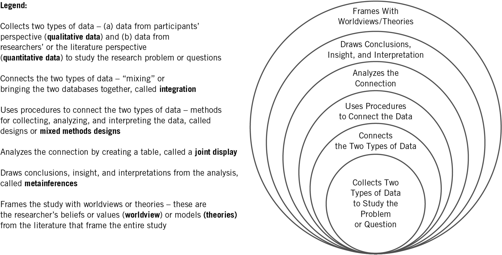
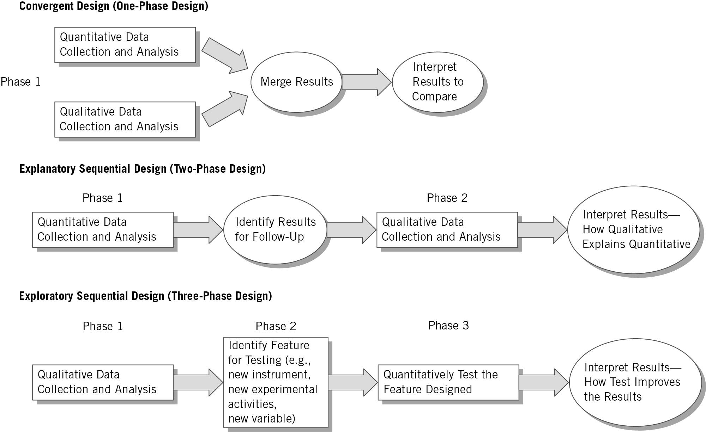
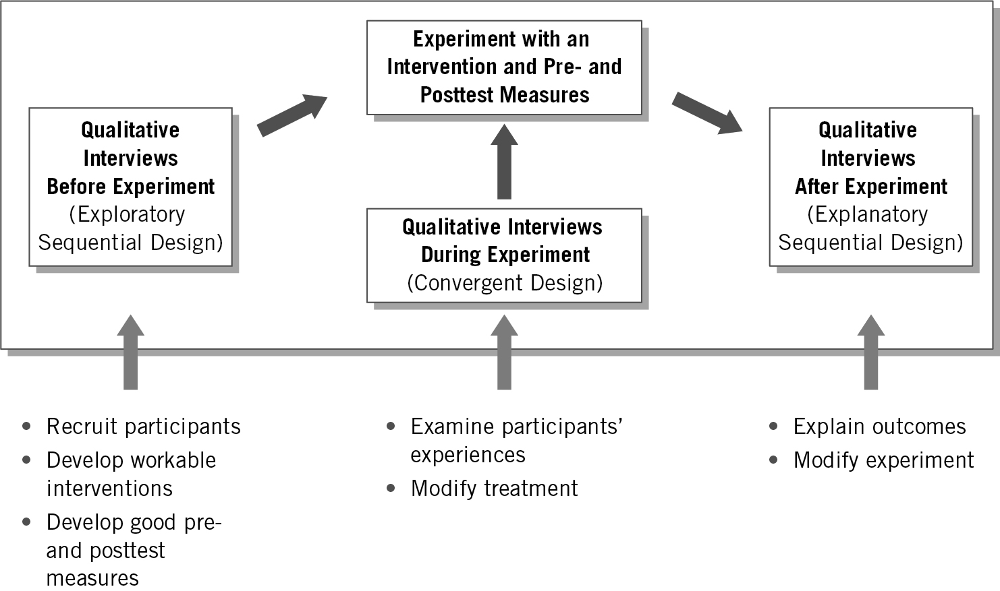
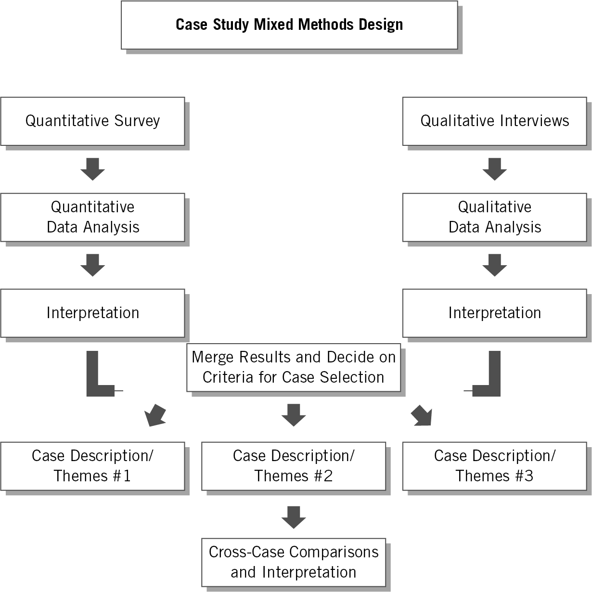
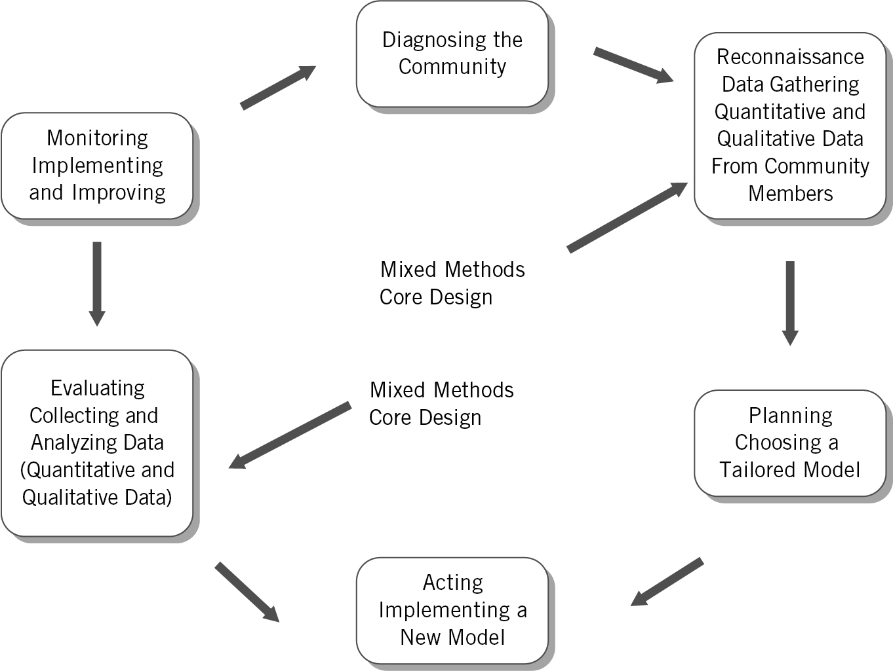
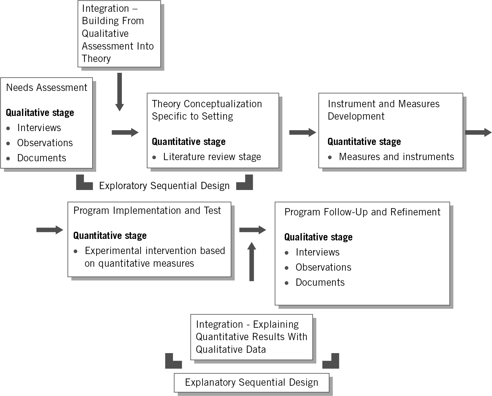
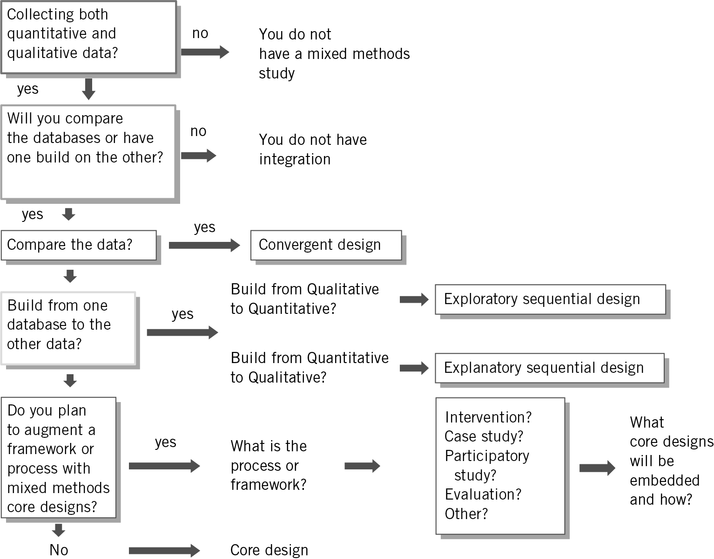
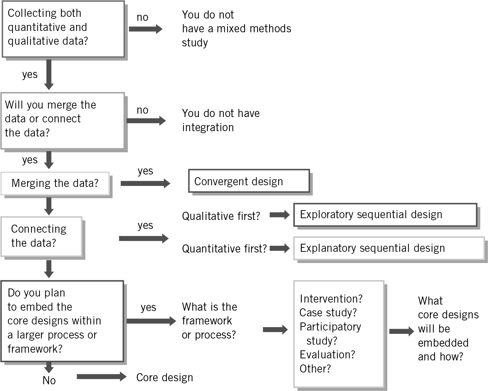

```{r setup, include=FALSE}

knitr::opts_chunk$set(echo = TRUE, message = FALSE, warning = FALSE,
                      dev = 'svglite', out.width = "45%", fig.width = 6,
                      fig.align="center")

options(scipen = 999)
```

## Acknowledgement of Country

I would like to acknowledge the Traditional Owners of Australia and  recognise their continuing connection to land, water and culture. The  University of Sydney is located on the land of the Gadigal people  of the Eora Nation. I pay my respects to their Elders, past and present.

# Chapter 10: Mixed Methods Procedures

Based on Creswell & Creswell (2022), Ch. 10

---

## Any question concerning the content for this week?

---

## What is your approach in your research proposal?

::: {style="text-align: center;"}


or <https://www.menti.com/al58cddjjy7b>
:::

---

## Plan for today

1. What is mixed methods research, and why use it
2. The three core designs: convergent, explanatory sequential, exploratory sequential
3. Group task: choose a design
4. Complex designs, and how to choose a design
5. Workshopping your research proposal
6. Key takeaways from GOVT6139
7. A3 in-class short answer, wrap-up and A2 Q&A

---

## Today's Learning Objectives {.smaller}

By the end of today's class, you will be able to:

1. **Define** mixed methods research by its six characteristics, and **justify** using it in a proposal

2. **Use** the key terms: open- and closed-ended data, research design, integration, joint display, metainferences

3. **Identify** for each core design its intent, data collection, integration procedure and metainferences

4. **Choose** a mixed methods design (core or complex) for a study, give reasons, and write an integration statement

5. **Summarise** your own research question and design (theory, data, methods) in a few sentences

# 1. What is mixed methods research?

---

## Mixed Methods Procedures

- Combines **qualitative** and **quantitative** data to understand a research problem better than either can alone
- Each type of data has its own **strengths and limitations**; combining them can offset the weaknesses
- Mixed methods is more than "doing both": the two databases have to be **integrated**

---

## Characteristics of Mixed Methods Research {.smaller}

The mixed methods researcher:

1. **Collects two types of data** (qualitative, *open-ended*, and quantitative, *closed-ended*) to study the research problem or question
2. **Connects the two data sets**, called *integration*
3. **Uses procedures to integrate** the two data sets, called a *mixed methods design*
4. **Analyses the integration**, typically in a table called a *joint display*, which presents the two databases together
5. **Draws conclusions**, insights or interpretations from the integration, called *metainferences*
6. **Frames the study** with the researcher's beliefs and values (**worldview**) and explanations drawn from the literature (**theories**)

---

## Essential Components of Mixed Methods Research

::: {style="text-align: center;"}

:::

::: aside
Creswell & Creswell (2022), Figure 10.1
:::

---

## Why Use Mixed Methods?

**Core reasons**

- Developing a **more complete understanding** of a research problem by combining quantitative and qualitative results
- **Explaining** quantitative results in more detail with qualitative data
- **Improving** measures, scales and instruments (e.g. a survey that fits the population)

**Also used for**

- Augmenting experiments
- Developing cases
- Evaluating programs
- Understanding the changes needed for a marginalised group

---

## Open-ended vs. Closed-ended Data

:::: columns
::: {.column width="50%"}
### Open-ended (qualitative)

- The researcher asks a question but **does not provide response options**
  - e.g. participants share their views in an interview, and the researcher records them
- Or the researcher provides a **qualitative description** of a document (e.g. a social media post)
:::

::: {.column width="50%"}
### Closed-ended (quantitative)

- The researcher **provides response options**
  - e.g. a rating scale (Likert)
- Or a document is **classified** into predefined categories (e.g. the topic of a social media post, assigned by software)
:::
::::

::: callout-note
Remember Week 12: the same newspaper article or post can be treated as qualitative **or** quantitative data. It depends on your approach.
:::

---

## Research Design: Core and Complex

The **research design** is the procedure used to conduct a mixed methods study. There are two categories:

:::: columns
::: {.column width="50%"}
### Core designs

Found in **all** mixed methods studies:

- Convergent
- Explanatory sequential
- Exploratory sequential
:::

::: {.column width="50%"}
### Complex designs

The primary intent is not simply to integrate two databases, but to have mixed methods **support** a larger process or framework (an experiment, a case study, an evaluation...)
:::
::::

---

## More Key Terminology

**Integration**

- The central concept in mixed methods research
- Combining information from the qualitative and quantitative data, in one study or a series of studies

**Joint display**

- A table or graph that presents the two databases **side by side**

**Metainferences**

- The insights that emerge when the researcher **compares** the quantitative and qualitative results

---

## The Process of Conducting a Mixed Methods Study

Connect the quantitative and qualitative data to a specific type of mixed methods design, then:

1. **Draw a diagram** of the design
2. **Integrate** the two databases
3. **Present** the integration in a joint display for analysis
4. **Draw metainferences** from the results of the integration

# 2. Core mixed methods designs

---

## Three Core Mixed Methods Designs

1. **Convergent** design (one-phase design)

2. **Explanatory sequential** design (two-phase design)

3. **Exploratory sequential** design (three-phase design)

---

## Three Core Designs

::: {style="text-align: center;"}

:::

::: aside
Creswell & Creswell (2022), Figure 10.2
:::

---

## The Convergent Design (1/2)

- **Intent:** to *compare* the results from the qualitative database with the results from the quantitative database by *merging* them
- **Key assumption:** quantitative and qualitative data provide **different types of information**
- The most familiar approach

**Description of the design**

- Collect both quantitative and qualitative data, usually at the same time
- Analyse them separately
- Compare the results to see whether the findings **confirm or disconfirm** each other

---

## The Convergent Design (2/2)

### Data collection

- Use the **same or parallel** variables, constructs or concepts in both databases
  - e.g. a survey item on trust in parliament, and an interview question on trust in parliament

### Data analysis and integration

- Analyse the qualitative database
- Analyse the quantitative database
- **Merge** the two in a joint display

---

## Joint Display: Convergent Design {.smaller}

| Scores | Theme 1 | Theme 2 | Theme 3 | Theme 4 | Metainferences |
|:-:|:-:|:-:|:-:|:-:|:-:|
| High | Quote/<br>Scores | Quote/<br>Scores | Quote/<br>Scores | Quote/<br>Scores | Insight |
| Medium | Quote/<br>Scores | Quote/<br>Scores | Quote/<br>Scores | Quote/<br>Scores | Insight |
| Low | Quote/<br>Scores | Quote/<br>Scores | Quote/<br>Scores | Quote/<br>Scores | Insight |
| **Metainferences** | Insight | Insight | Insight | Insight | Insight |

::: aside
Creswell & Creswell (2022), Table 10.2
:::

---

## The Explanatory Sequential Design (1/2)

- **Intent:** to *explain* initial quantitative results with qualitative data by *connecting* the two databases
- **Key assumption:** quantitative results may yield **surprising** information that needs explanation

**Description of the design**

- A **two-phase** project
- Phase 1: collect and analyse **quantitative** data
- Use the results to plan the second, **qualitative** phase
- The qualitative data explain the initial quantitative results in more detail

---

## The Explanatory Sequential Design (2/2)

### Data collection

- Two distinct phases
- **Rigorous** quantitative sampling in phase 1, **purposeful** qualitative sampling in phase 2

### Data analysis and integration

- **Connect** the quantitative results to the qualitative data collection
- The quantitative results decide **who** to sample and **what** to ask
  - e.g. interview respondents whose survey scores were unexpectedly high or low

---

## Joint Display: Explanatory Sequential Design

| Quantitative Scores | Qualitative Follow-up Themes | Metainferences |
|:-:|:-:|:-:|
| High scores | Theme 1<br>Theme 2<br>Theme 3 | How the themes explain the scores |
| Medium scores | Theme 1<br>Theme 2<br>Theme 3 | How the themes explain the scores |
| Low scores | Theme 1<br>Theme 2<br>Theme 3 | How the themes explain the scores |

::: aside
Creswell & Creswell (2022), Table 10.3
:::

---

## The Exploratory Sequential Design (1/2)

- **Intent:** to *explore* a problem qualitatively first, and use the findings to **build** better quantitative measures, scales or instruments
- **Key assumption:** existing measures or instruments may **not fit** the population or setting under study

**Description of the design**

- A **three-phase** design
- Phase 1: start with a **qualitative** exploration
- Phase 2: **build** a feature to be tested (e.g. a survey instrument, an intervention, new variables)
- Phase 3: a **quantitative** phase that tests the feature

---

## The Exploratory Sequential Design (2/2)

### Data collection

- Initial qualitative data collection
- Quantitative test of the feature

### Data analysis and integration

- Analyse the two databases separately
- Use the findings from the exploratory database to **build** the feature
- The qualitative findings shape the design of the quantitative phase (instrument, variables)

---

## Joint Display: Exploratory Sequential Design

Using a survey design as an example:

| Qualitative | Design Feature | Metainferences |
|:-:|:-:|:-:|
| Qualitative quotes | Quantitative survey items | Analyse the scores on the survey |
| Qualitative codes | Quantitative survey variables | Identify variables |
| Qualitative themes | Quantitative survey scales | Identify scales |

::: aside
Creswell & Creswell (2022), Table 10.4
:::

---

## Core Designs at a Glance {.smaller}

| Design | Intent | Procedure | Sequence |
|:--|:--|:--|:--|
| **Convergent** | Compare, corroborate, get a complete understanding | **Merge** the two databases | QUAN + QUAL at the same time |
| **Explanatory sequential** | Explain, expand | **Connect**: quant results shape qual data collection | QUAN → QUAL |
| **Exploratory sequential** | Build, transfer, generalise | **Connect**: qual results shape a quant feature that is then tested | QUAL → feature → QUAN |

# 3. Group task

---

## 👥 Group Task: Choose a Design {.smaller}

Each group takes **one** scenario. Choose a core design, then answer:

1. What is the **intent** of mixing (compare, explain, or build)?
2. Which comes first: quantitative, qualitative, or both together?
3. How are the databases **integrated**: merge or connect?
4. Sketch the **joint display**: what goes in the rows and columns?

:::: columns
::: {.column width="33%"}
**A.** A national survey finds that young voters in regional areas trust local councils **more** than young voters in cities. Nobody expected this.
:::

::: {.column width="33%"}
**B.** You want to measure attitudes towards AI among civil servants in a country where no validated survey items exist in the local language.
:::

::: {.column width="33%"}
**C.** You want to know whether parliamentary speeches on climate and public comments on the same bills tell the **same story**, at the same time.
:::
::::

```{r echo = FALSE}
library(countdown)

countdown(minutes = 10, seconds = 00, top = TRUE)
```

# 4. Complex designs and choosing a design

---

## Complex Mixed Methods Designs

- All mixed methods studies have at least one **core design** (convergent, explanatory sequential or exploratory sequential)
- **Complex designs** embed core designs in a framework that is larger than collecting, analysing and integrating two databases

Core designs can be embedded:

- in a **primary quantitative or qualitative design** (e.g. an experiment or intervention)
- in **another methodology** (e.g. an evaluation)
- in a **theoretical framework** (e.g. social justice)

---

## Examples of Complex Designs

- **Mixed methods experimental (intervention) design:** quantitative and qualitative data within an experiment or trial (Figure 10.3)
- **Mixed methods case study design:** mixed methods within a single or multiple case study (Figure 10.4)
- **Mixed methods participatory-social justice design:** a core design within a larger participatory or social justice framework (Figure 10.5)
- **Mixed methods evaluation design:** one or more core designs within an evaluation (Figure 10.6)

---

## A Mixed Methods Intervention Design

::: {style="text-align: center;"}

:::

::: aside
Creswell & Creswell (2022), Figure 10.3
:::

---

## A Multiple Case Study Design

::: {style="text-align: center;"}

:::

::: aside
Creswell & Creswell (2022), Figure 10.4
:::

---

## A Participatory Action Research Design

::: {style="text-align: center;"}

:::

::: aside
Creswell & Creswell (2022), Figure 10.5
:::

---

## A Mixed Methods Evaluation Design

::: {style="text-align: center;"}

:::

::: aside
Creswell & Creswell (2022), Figure 10.6
:::

---

## Incorporating Core Designs into Complex Designs

1. Identify the quantitative and qualitative data collection
2. Draw a diagram of the steps in the process or framework
3. Look in those steps for opportunities to collect quantitative and qualitative data
4. Examine how the databases are connected (which core design?)
5. Discuss the overall framework and the core designs embedded in it

---

## Choosing a Design: Intent and Procedures

1. **Write an integration statement**: what will mixing the two databases let you learn?

> "Integration involved comparing the results from the quantitative and qualitative data by merging so that a more complete understanding emerges than provided by the quantitative or the qualitative results alone." (convergent design example)

2. Identify the **intent** of your design
3. Select **procedures** that match that intent

---

## Intent and Procedures of Mixed Methods Designs {.smaller}

| Design | Intent (of mixing the two databases) | Procedure |
|:--|:--|:--|
| **Convergent** | Compare, match, corroborate (validate), expand, enhance, diffract, identify cases, initiate, complete understanding | **Merge**: put the databases side by side |
| **Explanatory sequential** | Expand, explain | **Connect**: quantitative results shape the qualitative data collection |
| **Exploratory sequential** | Build upon, transfer, generalise | **Connect**: qualitative results lead to a quantitative feature, which is then tested |
| **Complex** | Augment (optimise, ascertain needs, monitor) | **Add** qualitative, quantitative or both types of data into a process or framework |

::: aside
Creswell & Creswell (2022), Table 10.5
:::

---

## Choosing Your Design Based on Intent

::: {style="text-align: center;"}

:::

::: aside
Creswell & Creswell (2022), Figure 10.7
:::

---

## Choosing Your Design Based on Procedures

::: {style="text-align: center;"}

:::

::: aside
Creswell & Creswell (2022), Figure 10.8
:::

---

## Other Reasons for Choosing a Design

- The designs that are **popular** in your field or discipline
- Whether you are a **single researcher** or a **team** (convergent designs are demanding for one person)
- The choice of **advisors or mentors**
- **Timing** of data collection: convergent (same time) or sequential
- **Emphasis** placed on each database: equal or unequal

---

## Checklist for a Mixed Methods Procedure {.smaller}

- ☐ Have you **defined** mixed methods research?
- ☐ Do you **justify** using mixed methods for your problem and question?
- ☐ Have you collected **both** quantitative and qualitative data?
- ☐ Have you described your **intent** for collecting both forms of data (integration statement)?
- ☐ Have you identified a **mixed methods design** to integrate your data?
- ☐ Have you provided a **diagram** of your design procedures?
- ☐ Have you identified how you will analyse the integration (**joint display**)?
- ☐ Have you drawn conclusions (**metainferences**) from the integration?
- ☐ Have you discussed **validity and ethics** related to your design?
- ☐ Have you **written** your study to reflect your design?

::: aside
Creswell & Creswell (2022), Table 10.1
:::

---

## Mixed Methods: Summary

In a mixed methods proposal:

- **Define** mixed methods and its core characteristics
- **Justify** your choice of design and discuss its challenges
- **Draw a diagram** of your procedures
- **Convey** the elements that follow from your design: data collection, integration, joint display, metainferences, validity

# Check-in

# 5. Workshopping your research proposal

---

## Workshopping Your Research Proposal

1. Write down your **research question** in a single sentence (if you have more than one question, focus on the first/main question)
2. Describe your **research design** in three sentences. Explain:
   - **theory:** what do you think is going on?
   - **data:** what data will you collect?
   - **methods/analysis:** how do you plan to analyse the data?

```{r echo = FALSE}
library(countdown)

countdown(minutes = 10, seconds = 00)
```


# 6. Key takeaways from GOVT6139

---

## Key Takeaways (1/2): Be a Critical Consumer of Research {.smaller}

**Where?** In your other units, in your career, and as an informed citizen.

**What does it mean to be a critical consumer?**

- Understand the strengths and weaknesses of different research approaches
- Understand what those strengths and weaknesses mean for the **inferences** we can draw from a study
  - *Inference:* "a conclusion reached on the basis of evidence and reasoning"

**A broad introduction to research design and methods**, useful for:

- a Masters or PhD
- research in the workplace
- evidence-based policymaking

---

## Key Takeaways (2/2): Questions to Ask of Any Study {.smaller}

- How did the researchers go about it? What **cases** did they select? What was the **timing**?
- Did they use quantitative or qualitative methods (or both)? What kind?
- Are they making **causal claims**? If so, does the evidence support their conclusions?
- Are the **measures valid**? Do they capture the concepts they claim to measure?
- What are the strengths and weaknesses in terms of **internal and external validity**?
- **Surveys and polls:** probability or non-probability sampling? Representative of which population? Do the questions fit the concepts of interest?
- **Interviews and other qualitative work:** who was interviewed, and in what context? Are the findings context-specific?
- If there are **several studies** on the topic, do the findings point in the same direction, or is there debate?


---

## A3 — In-class Short Answer

Take 10 minutes to complete this week's A3 short answer on Canvas — worth 10 points, marked 0 / 5 / 10 (≤ 100 words).

Would a **mixed methods design** strengthen **your own** research project?

- **If yes:** name the core (or complex) design, and state its **intent** (compare, explain, or build) and its **procedure** (merge or connect) for your specific quantitative and qualitative data.
- **If no:** explain why a single-method approach is enough for your question, or which design you would add if resources allowed, and why.

```{r echo = FALSE}
library(countdown)

countdown(minutes = 10, seconds = 00)
```

# Wrapping up

---

## Your Feedback

:::: columns
::: {.column width="55%"}
I'd be very keen to hear:

- What you enjoyed or found useful for your learning
- Constructive feedback on what could be improved, e.g.:
  - overall design of the unit and coverage of topics
  - assessment items (viva, proposal, weekly A3)
  - pace and level of the class
  - the peer-review exercise
:::

::: {.column width="45%"}
::: {style="text-align: center;"}


<https://student-surveys.sydney.edu.au>
:::
:::
::::

---

## Thank You!

- Thank you all for your participation and engagement in this unit!
- Congratulations on making it this far, and all the best with the research proposal
- Stay in touch!

::: {style="text-align: center;"}

:::

# A2 Research Proposal: Q&A
